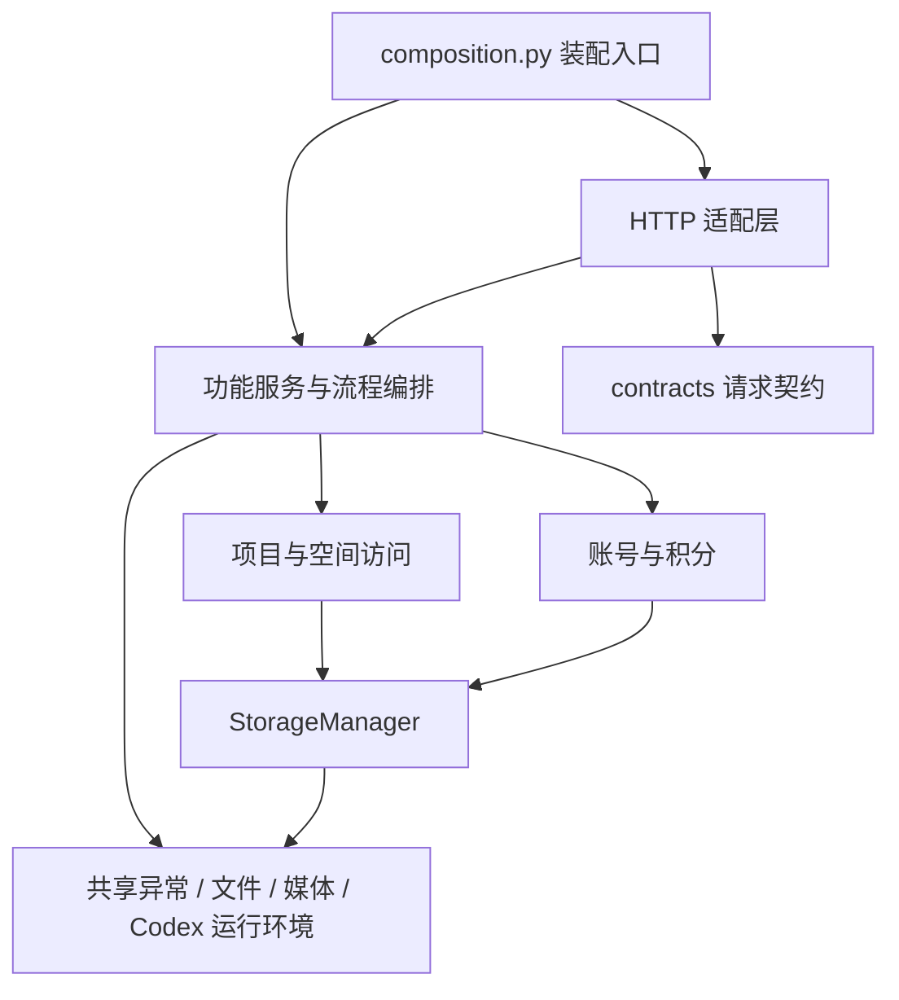

# 模块结构与安全修改指南

网站采用模块化单体：保留现有 Python 进程、FastAPI、JSON/SQLite 存储和独立 Worker。
模块按职责维护，通过服务接口协作。改一个功能前，可先运行该功能检查；发布前运行完整检查。
架构检查、接口兼容检查和行为回归共同降低跨功能回归风险，不能保证任意修改都不影响其他功能。

2026-10-20 后续治理审计见 [当前架构](architecture/CURRENT_ARCHITECTURE.md)、
[模块职责](architecture/MODULE_MAP.md)、[依赖审计](architecture/DEPENDENCY_AUDIT.md)、
[技术债](architecture/TECHNICAL_DEBT.md) 与 [七个开源项目研究](architecture/OPEN_SOURCE_ARCHITECTURE_RESEARCH.md)。
本指南保留日常修改入口；审计区分静态导入和运行时耦合，不把候选能力视为已实现。

## 从哪里修改

| 修改目标 | 实现入口 | 需守住的边界 |
| --- | --- | --- |
| 全站功能装配 | `image_workbench/composition.py` | 创建服务后注入路由；不在这里实现业务规则 |
| 公开 Web 入口 | `image_workbench/web.py` | 保留 `create_app`、`create_workspace_app` 及原有公开导入 |
| 登录、账号、空间、分发 | `accounts_web.py`、`accounts.py`、`workspace_scope.py` | 每次请求验证身份与当前空间，不复用未限定空间的视图 |
| 请求安全与错误响应 | `http_api/guard.py`、`http_api/errors.py` | Host/Origin、CSRF、请求体大小、权限与错误脱敏 |
| 图片项目及子项目接口 | `http_api/projects.py` | 逻辑归属与文件路径分离，保留迁移规则 |
| 图片任务接口、上传 | `http_api/tasks.py`、`http_api/uploads.py` | 保存不执行；上传临时文件必须清理；明确提交才冻结积分 |
| 图片下载、审核 | `http_api/artifacts.py` | 校验所属空间、文件大小与哈希 |
| 图片状态写入、提交 | `workbench_state.py` | 任务锁、请求去重、冻结与恢复 |
| 图片默认 Skill 与风格 | `image_prompting.py`、`skills/image-generation-default/` | 只整理提示词与风格；通过现有任务执行，保留原始需求与快照，不调用额外模型或改动积分 |
| 图片列表和详情 | `image_queries.py`、`image_status.py` | 查询投影、状态推导、计时口径；不启动任务 |
| 脚本生成 | `script_service.py`、`script_models.py`、`script_templates.py` | 固定报价、版本不可覆盖、仅显式执行 |
| 脚本→分镜协调 | `script_workflow.py` | 通过公开源版本/规划阶段端口协作；脚本事务结束后触发，重启消费已保存意图 |
| 统一恢复诊断 | `task_recovery.py` 及三种媒体的 recovery 接口 | 只读状态/失败/证据/动作；不调用模型、补偿任务或结算 |
| 脚本插件与启停 | `plugin_api.py`、`script_plugin.py` | 显式注册；通过 ScriptServicePort 复用任务、积分、产物、版本；停用保留历史和恢复 |
| 脚本素材与模板 | `script_resources.py`、`script_engine.py`、`script_resource_web.py` | 空间隔离、结构解析、上传内容作为数据 |
| 分镜规划 | `storyboard_service.py`、`storyboard_models.py`、`storyboard_planner.py` | 独立规划服务，通过已有脚本/视频服务衔接 |
| 视频任务 | `video_store.py`、`h3_worker.py`、`video_web.py` | 任务回执、计费、媒体限制；视频持久化由 VideoStore 维护 |
| 图片→脚本→视频联动 | `pipeline_service.py`、`video_pipeline.py` | HTTP 只解析输入；流程由服务编排，调用 VideoStore 的公开接口 |
| 远程执行协议 | `remote_queue.py`、`script_remote.py`；`http_api/*_workers.py` | 队列实现不导入 FastAPI；断线只对账和回传，不自动重跑 |
| 请求模型 | `contracts/` | 不导入业务实现或页面；保留现有字段与默认值 |
| 通用异常、文件、媒体校验 | `domain_errors.py`、`managed_files.py`、`atomic_files.py`、`media_validation.py` | 文件端口限制目录并验证路径；调用者负责先核验 Workspace 与资源归属 |
| Codex 运行环境 | `codex_runtime.py` | 图片与文本共同使用可执行文件定位、子进程环境与终止规则 |
| 管理检查、发布 | `admin_operations.py`、`admin_web.py`、`scripts/deploy_release.py` | 检查与发布包绑定同一源码；正式发布仍是独立操作 |

表中未带目录的 Python 文件均位于 `image_workbench/`。脚本素材与分镜功能在同一目录由同期工作新增，
本次重构将它们纳入模块边界，不将它们算作本次新增业务功能。

## 依赖方向



实际允许的导入关系以根目录 `architecture.json` 为准，图只表达主要方向。
图片、脚本、视频不允许彼此直接导入实现；需要共享的能力下沉到稳定底层，
需要联动的流程通过注入的服务或端口组织。分镜属于跨脚本/视频的编排功能，单独声明依赖。

`PipelineVideoPort` 明确列出联动流程需要的视频能力。`VideoStore.pipeline_project`、
`ensure_pipeline_binding` 和 `set_pipeline_script` 负责所属空间校验、锁及落盘，
流程不再直接访问视频模块的 `_project`、`_write`、`_project_path`。

共享异常仍可从原入口导入；例如 `workbench_state.ConflictError` 与
`domain_errors.ConflictError` 是同一个类。旧 Worker 的文件工具别名也保留，
新代码直接从共享模块导入。兼容别名不应该成为新依赖的入口。

## 前端组件

`web_static/workbench.js` 保留图片页的项目/任务协调。以下组件通过工厂参数接收回调与当前值，
各自不能读取页面的 `state` 或调用其他组件的全局对象：

| 文件 | 职责 |
| --- | --- |
| `workbench-api.js` | 请求头、当前 Workspace/CSRF、JSON/表单、可读错误、未登录回调 |
| `workbench-accounts.js` | 账号信息、空间选择、积分记录、回收站界面 |
| `workbench-preview.js` | 图片打开/关闭、过期异步结果取消、键盘焦点恢复 |
| `workbench-format.js` | 状态、日期、体积和耗时显示，无页面状态或网络 |
| `workbench-prompt-enhancement.js` | 提示词强化的本地校验、请求、原文/结果对比与“使用强化版”回填；不提交生成、不扣积分 |

沿用原生 `defer` 脚本，无需增加构建器。模板必须先加载组件再加载页面入口；
页面资源版本包含上述全部组件文件，更新组件后刷新页面即可获取新版本。
图片执行耗时以服务端返回值为基准，页面用单调时钟每秒更新文字；状态查询仍每 3 秒进行，
收到响应后校准，排队、结束、状态待确认或切换任务时停止本地计时。最终耗时采用服务端记录。
提示词强化服务只返回文本与技能来源；生成、积分和文件登记仍由既有任务链负责。
现有图片查看、对比、脚本页、视频页和管理页仍有自己的独立文件。

视频 `IWVideo` 不导出可变 state。消费者通过 `snapshot` 读取副本，用 `captureContext/isCurrent` 核对
账号、空间、项目和页面修订；`setReferences/addReferences` 另核对镜头草稿修订，`refreshProject`
统一控制异步项目更新的先后。页面事件也只传副本，切换后晚到的上传、报价和刷新不能覆盖当前草稿。

## 验证命令

在项目根目录运行：

```powershell
# 快速检查导入边界、循环、未知模块及前端装配顺序
.\.venv\Scripts\python.exe -X utf8 scripts\check_architecture.py

# 只检查一个功能，同时运行公共契约和请求边界检查
.\.venv\Scripts\python.exe -X utf8 scripts\verify.py --module video

# 查看一个功能会执行哪些测试
.\.venv\Scripts\python.exe -X utf8 scripts\verify.py --module scripts --list

# 完整回归
.\.venv\Scripts\python.exe -X utf8 scripts\verify.py

# 输出可机器读取的依赖图
.\.venv\Scripts\python.exe -X utf8 scripts\check_architecture.py --json
```

可选功能为 `images`、`projects`、`accounts`、`scripts`、`storyboards`、`video`、
`admin`、`storage`。修改共享底层、权限、计费、队列和恢复逻辑时运行完整回归。

检查包括：

- 固定版本 Ruff 的历史基线增量检查；新诊断失败，旧问题不批量自动修复，详见 [质量检查](architecture/QUALITY_GATES.md)。
- Python 静态导入（含函数内和条件分支内导入）的模块归属、允许方向与循环。
- 业务/底层模块不得导入 FastAPI 或 Starlette。
- 前端组件先于入口加载，组件不访问页面状态或相邻组件全局对象。
- 原有 107 个接口的路径、方法、参数、旧字段约束和默认值；允许新增接口和可选字段，
  新必填字段、删除旧字段、收紧原有约束等会失败。
- 现有行为回归，新增纯服务测试，以及 Node 原生测试运行器执行的请求/预览行为检查。
- 验证开始和结束比较源码指纹；期间有其他编辑时返回失败，避免把旧结果当成当前源码的通过证明。

`tests/test_architecture.py`、`tests/test_http_contract.py` 与 `tests/test_frontend_modules.py`
在普通 `unittest discover` 中执行，因此现有发布程序和管理中心的完整检查也会运行它们。
没有 Node 时，普通 unittest 会明确跳过前端运行检查；CI 配置安装 Node 24 后执行完整验证。
工作流调用统一 `verify.py`；当前修改是否已在 GitHub 或生产执行，须查对应运行记录，不由本指南推断。

静态导入检查不能证明运行时对象调用完全独立，也不替代业务测试；
不要用动态导入、`getattr` 或从入口重新导出实现来规避边界。
生产模型、GPU、网络及云端部署状态仍需在相应环境单独验收。

## 新功能接入与回滚

新增功能时，先确定服务/存储所有者及输入输出，再加入 HTTP 适配器，最后在
`composition.py` 注入依赖。向 `architecture.json` 登记模块和必要依赖，
不要为了通过检查把整个业务层改为允许任意导入。跨功能协作优先新增明确接口。

调整接口应保留旧客户端行为；必须改变协议时，提供迁移或版本策略，再有依据地更新契约快照。
不能直接用新快照覆盖测试失败。本轮接口快照基于重构前的真实应用生成；
同期新增的可选脚本/分镜字段使用兼容性检查放行，旧约束仍逐项核对。

前一轮模块化工作开始时 Git 没有提交，其源码基线位于
`work/modularization-20261020/source-before.zip`，旁边保存 SHA256。
由于同一目录还有同期新增功能，回滚须按文件与变更范围合并；
**不能整包覆盖当前目录，否则会丢失后续改动。** 验证记录、浏览器截图和本轮计划也在该目录。
该记录属于历史模块化工作。后续架构治理另有 `work/architecture-governance-20261020/source-before.zip`；
插件回滚步骤见 [试点说明](architecture/PLUGIN_PILOT.md)。本轮治理没有迁移业务数据或发布。

## 参考与取舍

- [Intense-Visions/harness-engineering](https://github.com/Intense-Visions/harness-engineering)：
  借鉴将依赖方向和验证步骤写成可执行约束的做法。
- [seddonym/import-linter](https://github.com/seddonym/import-linter)：
  借鉴 Python 模块导入契约，将允许和禁止的依赖显式化。

当前项目已有 unittest 和成熟的任务/积分持久化路径，因此采用小型标准库 AST 检查器、
现有回归和公开服务接口，没有安装上述项目的插件，也没有引入新的业务运行依赖。
后续治理增加 Ruff 开发依赖和显式 Python 插件契约；Import Linter、Pluggy 等采用决策以
[开源研究](architecture/OPEN_SOURCE_ARCHITECTURE_RESEARCH.md) 为准。
