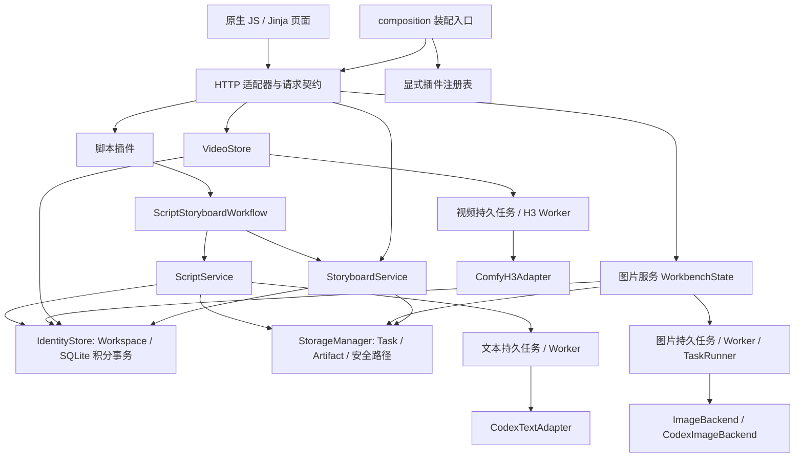

# 当前架构审计

审计起点：2026-10-20；状态更新：2026-10-22。依据工作区源码、静态导入图、实际调用点和离线测试；不是生产状态报告。
日常修改入口仍为 [架构指南](../architecture.md)，允许依赖的唯一机器配置为 [architecture.json](../../architecture.json)。
职责索引见 [模块图](MODULE_MAP.md)，具体问题见 [依赖审计](DEPENDENCY_AUDIT.md) 与 [技术债](TECHNICAL_DEBT.md)。

## 结论

继续采用模块化单体，保留 FastAPI、JSON/SQLite 和独立 Worker。当前没有统一的通用 TaskRunner：
`TaskRunner` 是图片执行器；脚本由 `ScriptService` 与文本 Worker 执行，视频由 `VideoStore` 与 H3 Worker 执行。
直接引入通用工作流框架，会产生第二套任务状态、恢复与计费协调，收益尚不足以抵消迁移风险。

基础模型和权限/积分已有共享实现，但“Core”不是独立目录，也不是完全与业务无关：
`storage.py` 知道 script/screenplay/storyboard/video 的文件类型；
`IdentityStore.reserve` 对脚本容量有特殊检查；
`ProjectManager` 借用图片执行记录做忙碌检查。
因此分层应先约束新依赖，再逐条缩小这些耦合，不能把目录重命名当作解耦完成。

本轮增加一个显式注册的 `ScriptGenerationPlugin`，通过应用服务复用任务、积分、产物和版本。
注册表不执行模型、不保存业务数据、不动态发现第三方包。详见 [插件试点与推广](PLUGIN_PILOT.md)。

## 运行与数据路径

图表达调用和数据所有权，不是逐条 Python 导入图。服务到 Worker 的箭头表示持久任务消费关系。
本地脚本 HTTP 通过 BackgroundTasks 调用已保存任务；远程模式通过 `ScriptRemoteQueue` 领取。
插件的 `submit` 只入队，不同步等待推理；本地后台调度和远程领取协议保持原状。

| 事实来源 | 当前所有者与说明 |
| --- | --- |
| Account / Workspace / 积分余额与账本 | `accounts.py` 的 `IdentityStore`；SQLite 事务统一处理 reserve / record_job；没有独立 `CreditService` 类 |
| 主项目 / 子项目 / 逻辑归属 | `ProjectManager` 的 catalog；`WorkspaceProjects` 每次核验账号空间；逻辑移动不搬媒体文件 |
| Task / Artifact | `models.py` 数据记录与 `StorageManager`；Artifact 包含来源、哈希、大小、路径；同一磁盘格式继续可读 |
| 图片 Version | Artifact 的 `source_artifact_id` 链；执行记录预分配 Artifact ID，归档可补齐 |
| 脚本 Version | `script-versions.json` 与不可变 TXT Artifact；`ScriptService._archive` 验证二者对应关系 |
| 分镜 Version | 独立 envelope / versions / pending_commit 与 JSON Artifact，带源脚本版本 |
| 视频结果 | `VideoStore` 自有 `.video/outputs` 及作业元数据；分镜输出/引用转换再登记共享 Artifact；不是全部视频天然已有统一 Version |
| 模型能力 | 图片 Protocol、脚本 `ScriptModelRegistry`、远程 Worker 上报目录、H3 配置、Qwen 配置各自拥有真实能力；没有跨媒体统一 Model Router |
| 价格 | 图片 `accounts.CreditCostCalculator.calculate`；脚本 `config/script_pricing.json`；分镜独立 pricing；视频持久配置 rates。计价口径不同，结算账本共享 |

## 确定性执行与 AI 判断

模型负责文本/分镜创作，Python 负责输入校验、Prompt 编译、结构校验、路径、冻结、归档和版本登记。
`video-script-generation`、`storyboard-planning` 的 Skill 作为受审阅资料已核对；没有让模型直接维护积分事务。
`image-asset-generation` 包含设计与 schema，并不等于所有规划接口已接入运行服务。
当前未找到独立 Continuity Agent、完整长视频拼接编排、Audio/TTS 或字幕服务，不能把候选功能写成已实现模块。

前端采用原生 JS IIFE、全局工厂/事件与 `defer`，没有 npm 模块构建流水线。
图片页四个组件已有回调注入。视频控制器只导出脱离内部对象的 `snapshot()` 和受上下文约束的命令；
`pipeline.js`、`storyboard.js` 不再读取或修改 `IWVideo.state`。项目、空间、页面修订和镜头草稿修订
共同约束异步结果；同一项目的并发刷新按请求顺序接纳最新结果。
前端负责展示与交互，服务端仍执行空间、价格、余额和幂等校验。

## 任务系统的八项能力

| 需求 | 当前证据与判断 | 限制 / 后续最小增强 |
| --- | --- | --- |
| 长视频耗时任务 | H3 单镜支持长耗时执行，`ComfyH3Adapter` 默认 timeout=7200，轮询并保存 journal；现有 H3 恢复测试覆盖断线 | 这是长耗时单镜，不是任意长成片/DAG；不能把超时当成模型已停止 |
| 防重复真实调用 | 图片稳定 job/execution ID；文本 started/completed 回执；H3 attempt_id、prompt_id、提交前 journal | 外部系统未提供完整幂等保证时不能宣称端到端 exactly-once；结果不明保持 uncertain |
| 阶段状态 | 原有执行记录保持；三种媒体使用 `task_recovery.recovery_projection` 返回统一状态、阶段、失败、证据和动作 | 只读派生信息，不代替各 Worker 的执行决定；底层未知阶段如实返回 unknown |
| 从失败阶段恢复 | `retry_archive`、`ScriptService.recover`、H3 原回执/精确图对账；重传与归档不调用生成 | 正文/回执丢失时需要人工核实，不能自动推测成功或重放 |
| 重启恢复 | SQLite reservation outbox 补 JSON；各 Worker 从持久 journal 接续；孤立 running 转 uncertain | 本地脚本 queued 仍靠现有 run 入口/后台调度；不是通用常驻调度器的自动恢复承诺 |
| 区分可重试失败 | 统一投影保留 original_status，动作标明 user/operator/worker 与是否可能调用模型；uncertain 不列出重新生成 | 原生状态和错误协议保留，执行前仍由各服务核验原证据 |
| 失败扣费 | `reserve` 冻结，`record_job` 成功 consume、明确失败 refund、uncertain 保留冻结；终态回传幂等 | JSON 与 SQLite 不是跨存储原子事务；依靠 outbox 和 reconciliation，需要持续故障注入回归 |
| 完成任务不重新付费执行 | 图片 run 使用 idempotency_key，脚本非 queued 立即返回，视频已结算不改变结果 | 新 attempt 必须是显式、经校验的新提交；清理 journal 会破坏恢复证据 |

相关实现：`task_runner.py:run/retry_archive`、`worker.py:LocalWorker.reconcile`、`remote_queue.py:complete`、
`script_service.py:submit/run/recover/_reconcile`、`script_remote_worker.py:_execute`、
`h3_worker.py:H3Worker`、`video_store.py:start/complete`、`accounts.py:reserve/record_job`。
测试集中在 `test_runner`、`test_worker`、`test_remote`、`test_script_recovery`、`test_h3_worker`、`test_video`。

脚本到分镜的报价计划、阶段触发和重启补偿由 `ScriptStoryboardWorkflow` 负责。脚本服务只接收
规范化选项和报价数据，不持有分镜服务；分镜服务通过注入的源版本读取函数取得不可变脚本。
本地执行、远程完成 HTTP 和启动恢复均在脚本事务/锁结束后调用协调器。原有请求指纹、阶段 ID、
源版本和 `storyboard_*` 持久字段继续兼容。存储路径与 JSON 原子写通过 `ManagedFiles` 的限定目录端口维护。

## 工作流框架决策

| 方案 | 能增加什么 | 迁移/运行代价 | 结论 |
| --- | --- | --- | --- |
| 增强现有执行体系 | 共用状态投影、错误分类、对账可见性；保留已验证幂等与积分协议 | 逐个服务加端口和故障测试，无新守护服务 | 当前采用 |
| Prefect | Flow/Task 编排、状态观测、可配置 retry/cache | 新结果与状态存储、服务/UI 运维、既有 worker 包装及付费边界重验证；缓存不替代账本事务 | 有明确跨阶段调度/观测瓶颈后，在不付费的编排流程上验证 |
| Temporal | 长流程历史重放、durable timers、worker/activity 恢复 | Temporal Service 与持久化运维、确定性 Workflow 编程、版本策略、Activity 幂等及账本桥接 | 跨主机长寿命流程和人工等待成为实际需求后评估 |

两种框架都不能替代外部付费调用的业务幂等、原回执和积分对账。上游实现与许可证依据见
[开源研究](OPEN_SOURCE_ARCHITECTURE_RESEARCH.md)。本轮不迁移任务状态、不改变自动重试策略。
